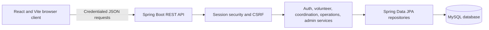
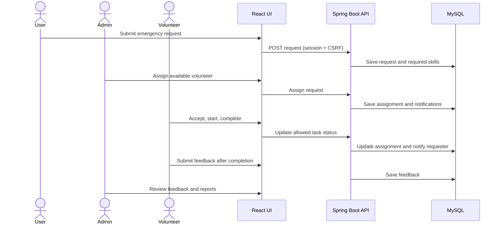

# DVC architecture

## Runtime components

The frontend uses Axios with `withCredentials`, a server session cookie, and the `XSRF-TOKEN` cookie/header pair for state-changing requests. API role checks are enforced by Spring Security and service-level ownership checks; client-side route guards only control navigation and are not the authorization boundary. Credentialed CORS allows the configured frontend origin (`dvc.cors.allowed-origin`, default `http://localhost:5173`).

## Main workflow

## Data and API references

- Relational entities and constraints are summarized in the [ER diagram](../database/ERD.md).
- Authentication, CSRF, and role routes are described in the [authentication API guide](../api/authentication.md).
- Local schema creation and MySQL setup are in [`database/README.md`](../../database/README.md).
- Feature-to-API-to-table mapping is in [`FEATURE_TRACEABILITY.md`](../../FEATURE_TRACEABILITY.md).

Integration tests use isolated in-memory H2 with MySQL compatibility mode. Local development uses MySQL. Production database migrations and deployment hosting are outside this development scaffold.
