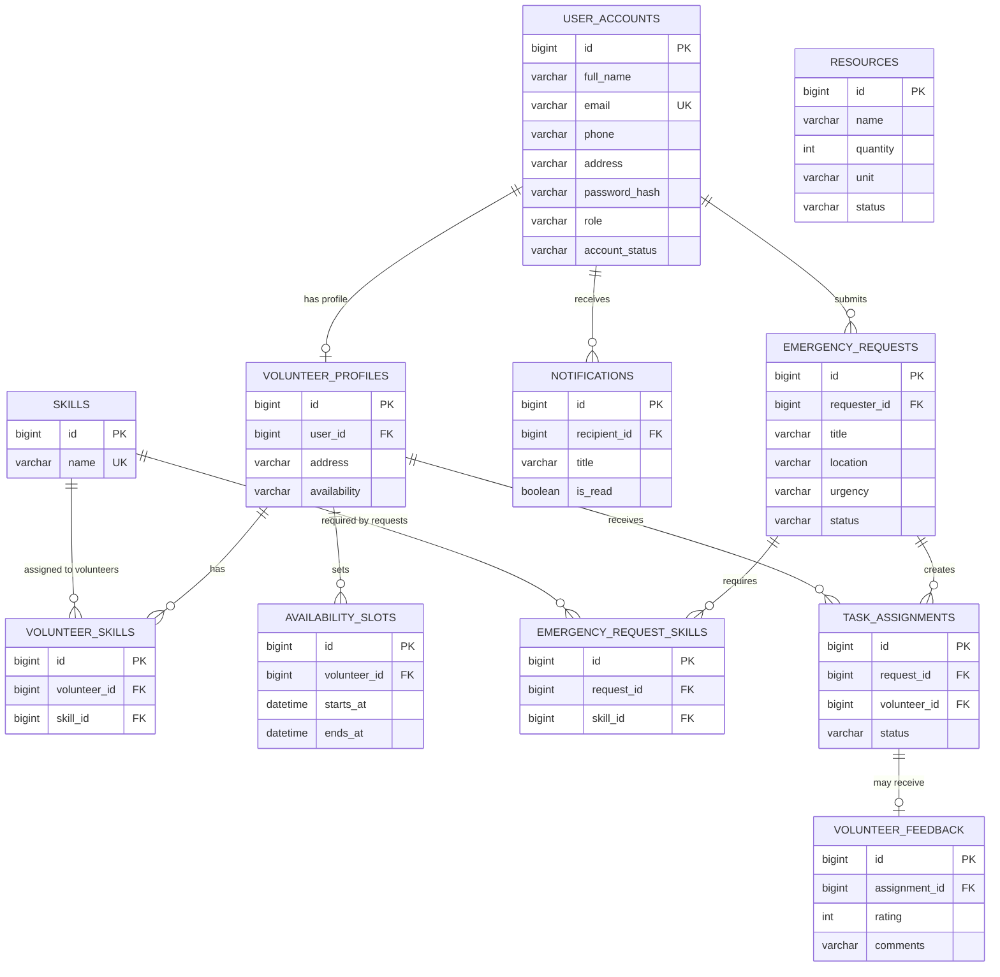

# DVC Initial Entity Relationship Diagram

This ER diagram reflects the Stage 2 JPA entities. The access-control and business workflows that use these records are planned for later stages.

Foreign keys are represented by JPA relationships. Unique constraints prevent duplicate account emails, duplicate skill names, duplicate volunteer/request skill links, duplicate request-volunteer assignments, and multiple feedback rows for one assignment. Query indexes cover common user role/status, request status/urgency, assignment status, availability lookup, resource status, and notification-recipient lookup.
